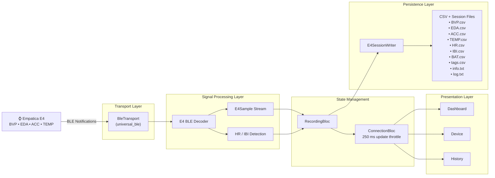

# Empatica Data Collector (e4_integrator)

A Flutter app that connects to an Empatica E4 wristband over Bluetooth Low Energy and
records its sensor streams to local CSV files — Android phone or Windows laptop, no cloud
and no Empatica Connect dependency.

> **Unaffiliated project.** "Empatica" and "E4" are trademarks of Empatica Srl. This is an
> independent, community research project, not sanctioned by or affiliated with Empatica.

> **Read this before you rely on any output.** Empatica
> [sunset the entire E4 software suite on 2025-02-14](https://www.empatica.com/research/e4-sunset/)
> (E4 Connect, E4 Manager, the E4 Streaming Server, the SDK — all permanently inoperative, no
> new API keys issued). This app talks to the E4 over a **reverse-engineered, unofficial BLE
> GATT profile** that Empatica has never published. The decoded `BVP.csv` is an unverified
> approximation, `HR.csv`/`IBI.csv` are self-derived from it, and `BAT.csv` is a best-effort
> guess. See [Caveats](#caveats--read-this-first) for the full list before using this for
> anything that matters.

[](#getting-started)
[](pubspec.yaml)
[](https://pub.dev/packages/universal_ble)
[](#license)

<!-- TODO: once CI/tests exist, add a build-passing / coverage badge here. Do not add one yet. -->

## Screenshots

<!-- TODO: screenshot — Dashboard tab (live BVP/EDA/ACC/TEMP charts). Save to docs/images/ and
     embed here, e.g.  -->
<!-- TODO: screenshot — Device tab (scan/connect flow). Save to docs/images/ and embed here. -->

## Features

- Direct BLE connect/disconnect on **Android and Windows** from one `E4Transport` interface
  (`lib/transport/e4_transport.dart`) — no TCP/E4-Streaming-Server path, which is dead
  post-sunset.
- Device discovery by name prefix `"Empatica E4"` (5-second scan) via
  [`universal_ble`](https://pub.dev/packages/universal_ble).
- Live decode of **BVP, EDA, ACC, TEMP** from reverse-engineered BLE characteristics.
- **HR and IBI derived on-device from the decoded BVP** signal via peak detection (not
  read from the E4 directly — see caveats).
- One-CSV-per-signal session output matching Empatica's own native export layout, with
  positional rows, gap-padding on dropped packets, a per-session `info.txt`, and a drop
  sidecar log (`e4_integrator_log.txt`).
- Two user-selectable recording modes: **continuous** (records for as long as the device is
  connected) and **manual** start/stop.
- `ConnectionBloc` + `RecordingBloc` state management with a ~250 ms UI throttle — every
  sample is still written to disk regardless of UI throttling.
- Responsive 3-tab UI (Dashboard live charts, Device, History) that adapts between phone
  (`NavigationBar`) and desktop (`NavigationRail`) layouts.
- **Experimental:** battery level via the standard BLE Battery Service (`0x180F`) —
  unconfirmed whether the E4 actually exposes it; fails silently if not present.

## Caveats — read this first

- **Sunset hardware.** Empatica's entire E4 software suite has been inoperative since
  2025-02-14. There is no way to validate this app's output against Empatica's own tooling.
- **Unofficial, reverse-engineered BLE profile.** Empatica has never published the E4's GATT
  profile. The characteristic UUIDs used here come from a third-party reverse-engineering
  effort ([`ismaelwarnants/e4-python-server`](https://github.com/ismaelwarnants/e4-python-server),
  flagged by its own author as unverified).
- **`BVP.csv` is an unverified approximation**, not a byte-identical decode of Empatica's
  proprietary BVP algorithm. It cannot be checked against a real streaming-server recording.
- **`HR.csv` and `IBI.csv` are self-derived**, computed in this app from the decoded BVP via a
  naive peak detector — they are not device-native values from the E4.
- **`BAT.csv` is experimental** — a best-effort read of the standard BLE Battery Service;
  unconfirmed that the E4 exposes it at all, and failures are swallowed (the file may simply
  never appear).
- **`tags.csv` will likely stay empty.** No BLE characteristic is known for the E4's physical
  tag button; `E4Signal.tag` is never emitted.
- **No automated Android runtime permission request yet.** The manifest declares the right
  Bluetooth (and, on Android ≤ 11, Location) permissions, but nothing in `lib/` requests them
  at runtime — grant them manually if the OS doesn't prompt you (see
  [Getting started](#getting-started)).
- **No session export/share and no persistent session history** are implemented yet — see
  [Roadmap](#roadmap).

## Architecture



One `E4Transport` interface (`lib/transport/e4_transport.dart`) hides the BLE transport from
parsing, storage and UI, so none of them need to know which platform they're running on. BVP
is decoded first and then run through a local peak detector to synthesize HR/IBI in-app, since
the E4 exposes no native characteristic for either. Every decoded sample is written to disk
immediately and unthrottled; the BLoCs only throttle their own UI state emission to ~250 ms.

## Getting started

### Prerequisites

- Flutter SDK (Dart `^3.12.2`, see `pubspec.yaml`)
- An Android device with BLE, **or** a Windows machine with a Bluetooth adapter
- For Windows builds: the "Desktop development with C++" workload in Visual Studio
  ([Flutter Windows build docs](https://docs.flutter.dev/platform-integration/windows/building))
- An Empatica E4 wristband, powered on and in range. Empatica's own apps (E4 Connect, E4
  Manager, etc.) are **not** required and are no longer usable since the 2025 sunset.

### Run it

```bash
git clone https://github.com/Vatsa0408/Empatica_E4_Wristband.git
cd Empatica_E4_Wristband
flutter pub get
flutter run
```

### Permissions

The Android manifest already declares `BLUETOOTH_SCAN`, `BLUETOOTH_CONNECT`, and (for API ≤
30) `ACCESS_FINE_LOCATION`. These are runtime permissions on Android 12+, and no runtime
request is wired up in the app yet — if scanning finds nothing, check your device's app
settings and grant Bluetooth (and Location, on Android 11 and below) manually.

## Output format

Sessions are written as one folder per connection:
`<unix-start-seconds>_<deviceId>/` — matching Empatica's own native E4 export layout:

| File | Rate | Notes |
|------|------|-------|
| `BVP.csv` | 64 Hz | Two-row header (t0, rate), one sample per row. Unverified approximation. |
| `EDA.csv` | 4 Hz | Two-row header, one sample per row. |
| `TEMP.csv` | 4 Hz | Two-row header, one sample per row. |
| `HR.csv` | 1 Hz | Two-row header, one sample per row. Self-derived from BVP. |
| `ACC.csv` | 32 Hz | Two-row header (rate row repeats 3x for x,y,z), 3 columns per row. |
| `IBI.csv` | irregular | Header `<t0>, IBI`, then `<elapsed>,<value>` rows. Self-derived from BVP. |
| `tags.csv` | — | Bare timestamps, no header row. Expected to stay empty (no BLE path). |
| `BAT.csv` | irregular | Not part of Empatica's format — a documented extension, written IBI-style. Experimental. |
| `info.txt` | — | Per-session notes restating these caveats. |
| `e4_integrator_log.txt` | — | Sidecar log of any gap-padded/dropped rows (not an Empatica file). |

Two correctness rules the writer follows (`lib/storage/e4_session_writer.dart`):

1. **`t0` is the first-received-sample timestamp per signal**, not wall-clock time.
2. **Rows are positional** — row *n* means `t0 + n/rate`. A dropped BLE packet is gap-padded
   (blank row) to keep every later row aligned, and the drop is logged to
   `e4_integrator_log.txt` rather than silently shifting timestamps.

**Where files land:**

- **Android:** app-specific external storage (visible over MTP/USB, no storage permission
  needed) — e.g. `Android/data/<package>/files/`.
- **Windows:** the directory containing the running executable — under `flutter run` that's
  the build output directory; for a packaged release, next to the `.exe`.

## Roadmap

- Real session export/share (the History tab's "Export" currently only flips an in-memory
  flag; `file_picker` is already a dependency but unused)
- Persistent session history (currently in-memory only, lost on app restart)
- Automated Android runtime permission request flow (`permission_handler` is already a
  dependency but unused)
- Validation of the reverse-engineered BVP decode and derived HR/IBI against a reference
  recording, if anyone with access to real Empatica streaming-server data can help
- CI and automated tests (`bloc_test` / `mocktail` are dev dependencies but no `test/`
  suite or CI config exists yet)

## Contributing

Contributions are welcome, especially from anyone who still has access to a working E4
Streaming Server recording or Empatica reference data — validating `BVP.csv` against a real
Empatica export is the single highest-value contribution this project can get.

- Transport/decoding lives in `lib/transport/` (`ble_transport.dart`,
  `e4_ble_decoder.dart`); storage in `lib/storage/e4_session_writer.dart`; state management in
  `lib/bloc/`.
- Run `flutter analyze` and keep platform-specific code behind the `E4Transport` interface —
  parsing, storage and UI should never branch on platform directly.
- Open an issue or pull request with what you found.

## License

<!-- TODO: no LICENSE file exists yet. Pick a license (MIT and Apache-2.0 are both compatible
     with universal_ble's BSD-3 license) and add a LICENSE file at the repo root; update this
     section and the badge above once decided. -->

## Authors

<!-- TODO: confirm public display name/attribution. -->

## Acknowledgments

- BLE characteristic UUIDs reverse-engineered by
  [`ismaelwarnants/e4-python-server`](https://github.com/ismaelwarnants/e4-python-server)
  (unverified, per its own author).
- Built with [`universal_ble`](https://pub.dev/packages/universal_ble),
  [`flutter_bloc`](https://pub.dev/packages/flutter_bloc), and
  [`path_provider`](https://pub.dev/packages/path_provider).
